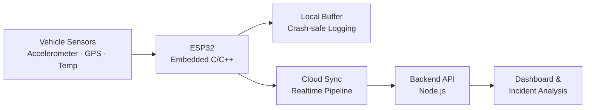
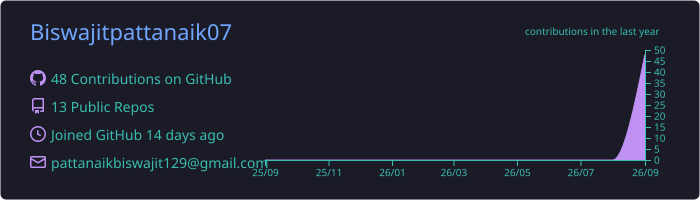
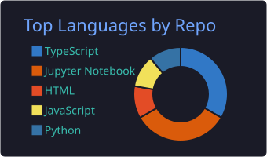
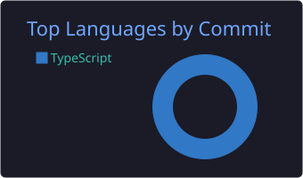
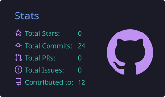

<p align="center">
  
</p>

<h1 align="center">Hi 👋, I'm Biswajit Pattanaik</h1>

<p align="center">
  
</p>

<p align="center">
  <a href="https://www.linkedin.com/in/biswajit-pattanaik-3586b82b3"></a>
  <a href="mailto:pattanaikbiswajit07@gmail.com"></a>
  <a href="https://github.com/Biswajitpattanaik07?tab=repositories"></a>
  <a href="https://rydex-smart-al-powered-ride-hailing-rho.vercel.app/admin/dashboard"></a>
</p>

<p align="center">
  
  
  
  
</p>


## 🚀 At a Glance

<table width="100%">
  <tr>
    <td width="50%" valign="top">

- 🔧 **Embedded Systems Developer** · IoT Engineer · Backend Developer
- 🧮 Strong in **DSA (C++)**, AI/ML, Cloud, and Full-Stack
- ⚡ Building **real-time, scalable, intelligent** systems
- 🌐 End-to-end: **sensor → firmware → cloud → web app → AI**

</td>
    <td width="50%" valign="top">

- 🏆 **IEEE Tech Spark 2.0 Winner**
- 🚕 Shipped **RYDEX** and 🛒 **CartSphere** (flagship platforms)
- 🚗 Built **AI Vehicle Black Box** and 🚆 **Bharatiya Rail Fault AI**
- 🎯 **Open to Internships & Full-Time roles**, available immediately

</td>
  </tr>
</table>


## 💫 About Me

Results-driven Embedded Systems and Software Developer with strong expertise across the full technology stack — from low-level hardware interfacing and sensor integration to cloud deployment and AI-powered application development.

Experienced in designing and implementing end-to-end IoT solutions that connect physical devices with scalable, data-driven backend systems, ensuring reliable and efficient system performance. Possesses a strong foundation in Data Structures and Algorithms, enabling the development of optimized, production-ready software across embedded, web, and enterprise environments.

Known for a systematic problem-solving approach and a strong passion for leveraging IoT, AI/ML, and modern software engineering practices to build innovative, scalable solutions that automate processes and deliver measurable real-world impact.

---

## 🔭 Current Focus

| Area | Details |
|---|---|
| 🚗 Automotive Embedded Systems | CAN, AUTOSAR |
| 📡 IoT + Cloud Integration | ESP32 + Raspberry Pi |
| 🤖 AI/ML in Embedded Systems | Applied ML on constrained devices |
| 🧠 AI & ML | Model development, deployment, and MLOps |
| 🏗 System Designing | Scalable, fault-tolerant architecture patterns |
| ⚙️ DevOps | CI/CD pipelines, containerization, cloud infra |
| 💻 Backend Systems | Node.js + APIs |

### 📚 Currently Learning

<p align="left">
  
  
  
  
</p>

### 💬 Ask Me About

<p align="left">
  
  
  
  
  
</p>


## 🎯 Skills Overview

A quick view of where I'm strongest. Each bar reflects my self-assessed level in that area.

| Area | Level | Proficiency |
|---|---|---|
| 🔧 Embedded Systems | **Advanced** | `██████████████████░░` 90% |
| 🧮 DSA (C++) | **Advanced** | `██████████████████░░` 90% |
| 💻 Backend Development | **Advanced** | `█████████████████░░░` 85% |
| 🌐 Full-Stack Development | **Advanced** | `█████████████████░░░` 85% |
| 🧠 AI / ML | **Intermediate** | `██████████████░░░░░░` 70% |
| ⚙️ DevOps & Cloud | **Intermediate** | `█████████████░░░░░░░` 65% |

<p align="left">
  
  
  
  
  
  
</p>

## 💻 Tech Stack

### 🧑‍💻 Programming Languages

<p align="left"></p>

### 🎨 Frontend & UI

<p align="left"></p>

### ⚙️ Backend, APIs & Databases

<p align="left"></p>

<p align="left">
  
  
  
  
  
  
  
  
  
</p>

### 🤖 AI / ML & Data Science

<p align="left">
  
  
  
  
  
  
</p>

<p align="left">
  
  
  
  
  
</p>

### 🔌 Embedded Systems & IoT

<p align="left">
  
  
  
  
</p>

<p align="left">
  
  
  
  
  
</p>

### ☁️ Cloud, DevOps & Tools

<p align="left"></p>

<p align="left">
  
  
  
</p>

### 🧠 Computer Science Fundamentals

<p align="left">
  
  
  
  
  
</p>


## 🏆 Featured Work

<table width="100%">
  <tr>
    <td width="50%" align="center" valign="top">
      <h3>🚕&nbsp; RYDEX</h3>
      <sub><i>AI-Powered Mobility Platform · Flagship</i></sub>
      <br/><br/>
      <p>Enterprise-grade, full-stack ride-hailing platform architected like a real production system — graph-based shortest-path driver matching, dual-checkpoint OTP ride integrity, live GPS tracking, Video KYC vendor onboarding, and defense-in-depth security across Rider, Driver, and Admin domains.</p>
      
      
      
      
      
      <br/><br/>
      <a href="https://rydex-smart-al-powered-ride-hailing-rho.vercel.app/admin/dashboard"></a>
    </td>
    <td width="50%" align="center" valign="top">
      <h3>🛒&nbsp; CartSphere</h3>
      <sub><i>Multi-Vendor E-Commerce SaaS · Flagship</i></sub>
      <br/><br/>
      <p>Enterprise-grade, multi-tenant marketplace platform where independent vendors run isolated storefronts under one roof — GST-verified vendor onboarding, admin-gated product approvals, order-scoped real-time chat, and live revenue analytics across Admin, Vendor, and Customer dashboards.</p>
      
      
      
      
      
    </td>
  </tr>
</table>

<table width="100%">
  <tr>
    <td width="50%" align="center" valign="top">
      <h3>🚗&nbsp; AI Vehicle Black Box</h3>
      <p>An embedded IoT system that continuously logs vehicle telemetry and sensor data for post-incident analysis — combining low-level hardware interfacing with real-time cloud data pipelines.</p>
      
      
      
    </td>
    <td width="50%" align="center" valign="top">
      <h3>🚆&nbsp; Bharatiya Rail — Track Fault AI</h3>
      <p>An AI-powered Streamlit app for railway field engineers: EfficientNetB0 defect classification, Grad-CAM explainability, severity triage, and automated PDF inspection reports.</p>
      
      
      
    </td>
  </tr>
</table>

### 🧩 How the AI Vehicle Black Box works



<details>
<summary><b>🚕 RYDEX — core features (click to expand)</b></summary>

<br/>

- 🧭 Graph-based **shortest-path driver matching**
- 🔐 **Dual-checkpoint OTP** ride integrity (pickup and drop)
- 📍 **Live GPS tracking** over WebSockets
- 🎥 **Video KYC** vendor onboarding with ZegoCloud
- 🛡️ Defense-in-depth security: JWT + OAuth 2.0 across Rider, Driver, and Admin domains

</details>

<details>
<summary><b>🛒 CartSphere — core features (click to expand)</b></summary>

<br/>

- 🏪 **Multi-tenant** vendor storefronts, isolated under one marketplace
- 🧾 **GST-verified** vendor onboarding
- ✅ **Admin-gated** product approvals
- 💬 **Order-scoped real-time chat** between customer and vendor
- 📈 Live revenue analytics for Admin, Vendor, and Customer dashboards

</details>

<details>
<summary><b>🚆 Bharatiya Rail — core features (click to expand)</b></summary>

<br/>

- 🧠 **EfficientNetB0** defect classification
- 🔥 **Grad-CAM** heatmaps for explainable predictions
- 🚦 **Severity triage** so engineers know what to fix first
- 📄 **Automated PDF** inspection reports

</details>


## 🎓 Education & Milestones

```
2024 — Present   🏫  Pursuing degree, deepening focus on Embedded Systems & AI
2025            🏆  IEEE Tech Spark 2.0 — Winner
2025            🚗  Built AI Vehicle Black Box (embedded telemetry system)
2026            🚕  Shipped RYDEX — full-stack AI mobility platform
2026            🛒  Shipped CartSphere — multi-vendor e-commerce SaaS
2026            🚆  Built Bharatiya Rail Track Fault Detection AI
```

## 🏅 Achievements

<p align="center">
  
  
  
  
  
</p>


## 📊 GitHub Analytics

<p align="center">
  
</p>

<p align="center">
  
</p>

<p align="center">
  
  
</p>

<p align="center">
  
  
</p>

**Contribution Snake** 🐍

<p align="center">
  
</p>


## ⚡ Fun Fact

> Went from wiring sensors on a breadboard to shipping full AI-powered web apps — still can't decide if I love hardware or software more, so I do both.

## 🤝 Let's Connect

I'm actively looking for **internships and full-time roles** in Embedded Systems, IoT, Backend, and AI/ML. If you're building something interesting, I'd love to talk.

<p align="center">
  <a href="mailto:pattanaikbiswajit07@gmail.com"></a>
  <a href="https://www.linkedin.com/in/biswajit-pattanaik-3586b82b3"></a>
</p>

<p align="center">
  <sub>⭐ If you like my work, consider starring a repo. Thanks for stopping by!</sub>
</p>


